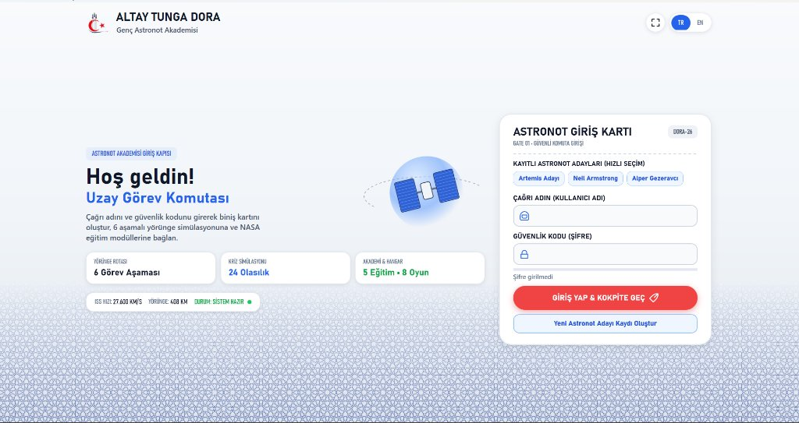
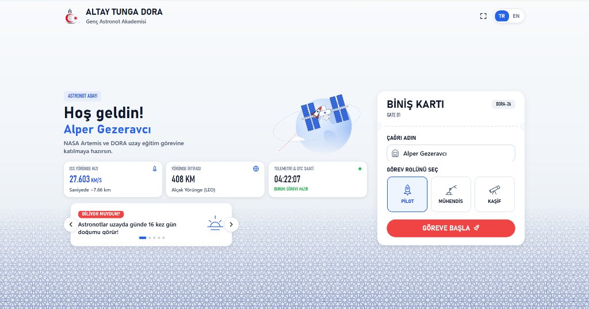
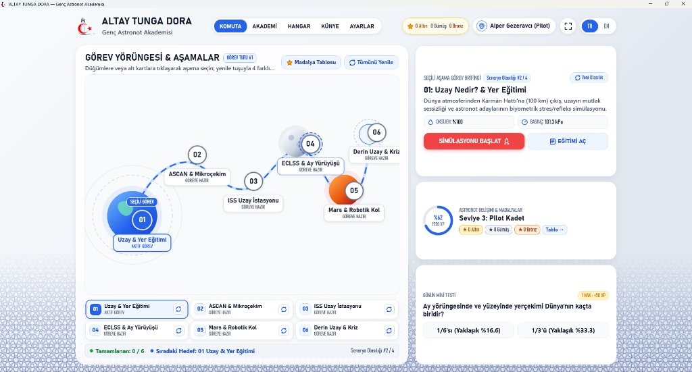
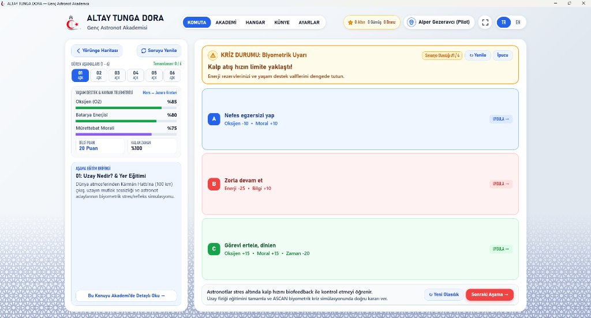
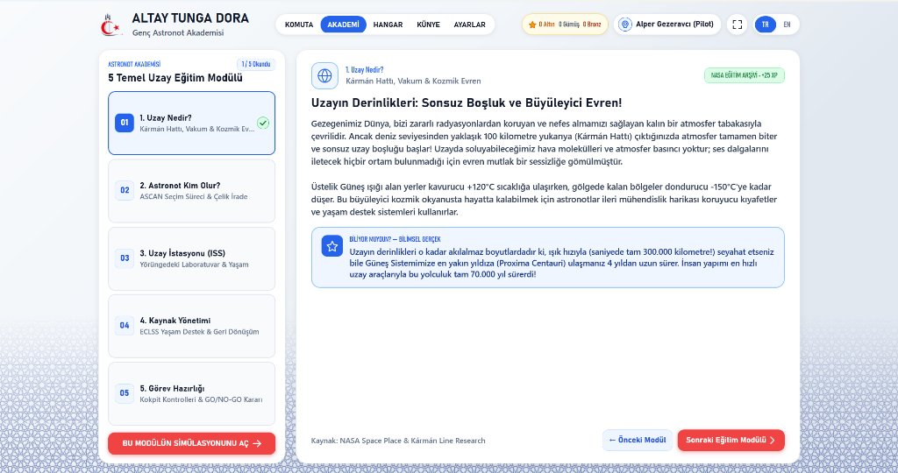
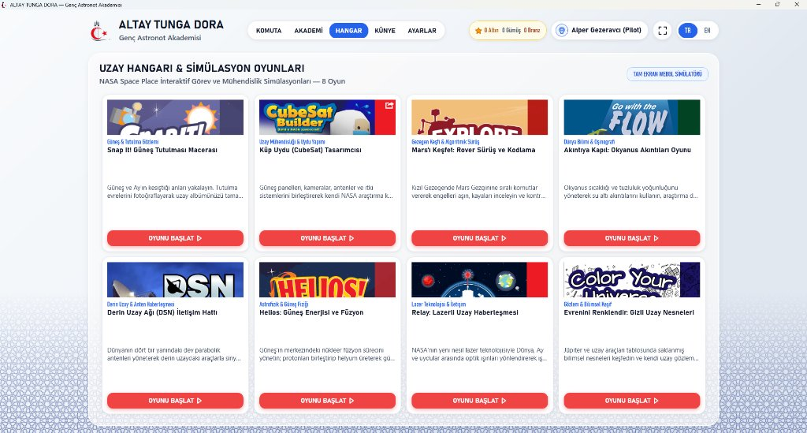
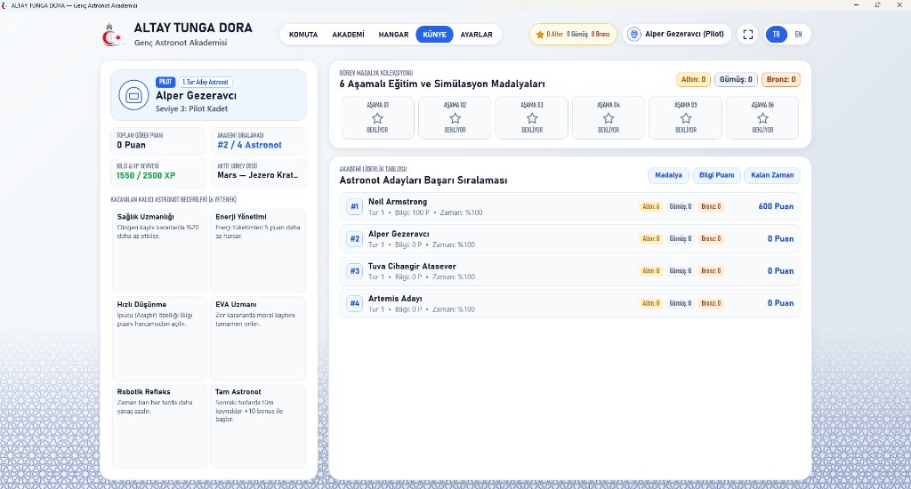
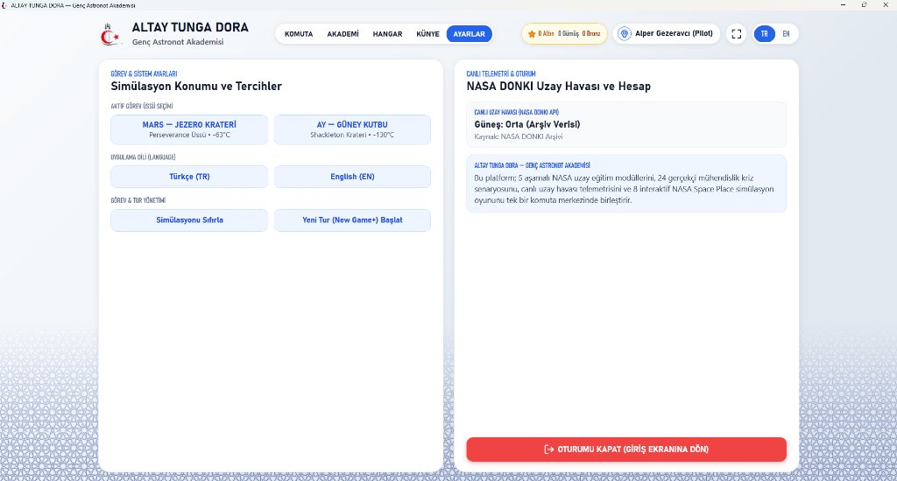

<div align="center">

# 🚀 D.O.R.A. — Deep Space Operations & Risk Analysis
### ALTAY TUNGA Young Astronaut Academy & Space Mission Simulation

[](https://dotnet.microsoft.com/)
[](https://learn.microsoft.com/dotnet/csharp/)
[](https://learn.microsoft.com/dotnet/desktop/wpf/)
[](https://learn.microsoft.com/dotnet/communitytoolkit/mvvm/)
[](https://developer.microsoft.com/microsoft-edge/webview2/)
[](https://api.nasa.gov/)
[](LICENSE)

*An advanced interactive desktop simulation platform designed to inspire youth in space science, provide astronaut training experiences, and hone critical decision-making under deep space emergency conditions.*

---

**English** • [Türkçe](README_TR.md)

---

[📖 About The Project](#-about-the-project) •
[📸 Screenshots](#-screenshots) •
[✨ Key Features](#-key-features) •
[🛰️ Mission Orbit Path](#️-mission-orbit-path-6-stages) •
[🛠️ Architecture & Tech Stack](#️-architecture--tech-stack) •
[🚀 Getting Started](#-getting-started) •
[👥 Altay-Tunga Team](#-team--contributors)

</div>

---

## 📖 About The Project

**D.O.R.A. (Deep Space Operations and Risk Analysis)** is an end-to-end desktop astronaut training and mission simulation software developed by the **Altay-Tunga Team**. 

The platform immerses aspiring astronauts into realistic aerospace challenges: from initial candidate screening (ASCAN) and Neutral Buoyancy Lab (NBL) underwater drills to International Space Station (ISS) docking, closed-loop environmental control (ECLSS), Canadarm2 robotics, and deep space solar flare crises.

Featuring live integration with the **NASA DONKI (Space Weather Database of Notifications, Knowledge, and Information) REST API**, the application fetches real-time solar flare and geomagnetic storm alerts, dynamically influencing spacecraft telemetry and decision parameters.

---

## 📸 Screenshots

| 🔐 01. Astronaut Boarding Gate & Login | 🛫 02. Launchpad & Boarding Pass |
|:---:|:---:|
|  |  |
| *SHA-256 secure authentication & interactive password strength analyzer* | *Personalized boarding pass, flight role selection & live telemetry bar* |

| 🛰️ 03. Mission Orbit Path & Stages | 🎛️ 04. Crisis Cockpit & Decision Tree |
|:---:|:---:|
|  |  |
| *6-stage dynamic orbital trajectory & stage progression map* | *Real-time telemetry, emergency crisis scenarios & A/B/C decision branches* |

| 📚 05. Space Academy | 🎮 06. Space Hangar & Simulators |
|:---:|:---:|
|  |  |
| *5 comprehensive space physics, aerospace engineering & astronaut modules* | *8 interactive NASA Space Place engineering & mission games via WebView2* |

| 🏅 07. Dossier, Medals & Leaderboard | ⚙️ 08. Simulation Settings & NASA DONKI |
|:---:|:---:|
|  |  |
| *Altay-Tunga insignia, astronaut dossier, medals showcase & leaderboard* | *Mars/Moon base selection, bilingual support (EN/TR) & live space weather* |

---

## ✨ Key Features

### 🔐 1. Secure Authentication & Astronaut Profiles
- **SHA-256 Hashing:** Astronaut credentials protected using salted SHA-256 encryption.
- **Dynamic Password Strength Meter:** Real-time visual feedback validating length, casing, numbers, and symbols.
- **Quick Profile Selection:** Pre-configured astronaut profiles for instant test and evaluation workflows.
- **Persistent Progress:** Automatic local storage of mission scores, medals, completed rounds, and unlocked skills.

### 🛫 2. Launchpad & Boarding Pass
- **Specialized Flight Roles:**
  - 🎖️ *Flight Director* — Strategic mission leadership and GO/NO-GO clearance
  - 🛰️ *Mission Specialist* — Scientific payloads and Extravehicular Activity (EVA)
  - ⚙️ *Flight Engineer* — Systems diagnostics, telemetry monitoring, and ECLSS
  - 📦 *Payload Specialist* — Cargo capture, robotics, and scientific hardware
- **Space Facts Carousel:** Bilingual (TR/EN) educational micro-cards covering microgravity and space physics.
- **Live Telemetry Strip:** Real-time indicators for cabin oxygen, pressure, crew pulse, and mission clock.

### 🎛️ 3. Mission Control & Simulation Cockpit
- **Interactive Orbit Progression Map:** 6 orbital stages with locked, active, and completed statuses.
- **Branching Decision Engine (Decision Tree):**
  - Multi-resource dynamics: Oxygen ($O_2$), Energy ($kWh$), Morale, Knowledge XP, and Time.
  - Three distinct resolution avenues: Standard, Risky, and Optimal engineering choices.
  - Contextual **NASA Learning Facts** and mission hints embedded into every crisis scenario.
- **Live NASA DONKI Space Weather Integration:**
  - Real-time REST API consumption tracking Class X, M, or C solar flares and coronal mass ejections (CME).
- **Embedded WebView2 Simulators:**
  - SpaceX ISS Docking Simulator
  - NASA Eyes on the Solar System
  - NASA Space Place Interactive Learning

### 📚 4. Space Academy
- Educational modules exploring orbital mechanics, the Kármán Line, vacuum thermodynamics, and closed-loop life support.
- Fully bilingual (English & Turkish) learning content.

### 🎮 5. Space Hangar (Mini-Simulations & Games)
- Curated collection of 8 interactive space engineering games:
  - *Color the Universe*, *CubeSat Builder*, *DSN Game (Deep Space Network)*, *Explore Mars Rover*, *Helios Fusion*, *Ocean Currents*, *Relay Laser Communications*, and *Snap It!*.

### 🏅 6. Astronaut Dossier & Achievements
- Distinctive Altay-Tunga aerospace branding and traditional motifs.
- Gold, Silver, and Bronze medal showcase for flawless mission execution.
- Skill tree unlocking operational bonuses (e.g., Medical Expertise, Fast Thinking, EVA Specialist, Robotic Reflexes).

---

## 🛰️ Mission Orbit Path (6 Stages)

| Stage | Mission Title | Core Focus | Operational Challenge |
|:---:|:---|:---|:---|
| **01** | **What is Space? & Ground Sim** | Kármán Line (100 km), vacuum physics, biometric stress screening. | Candidate biometric stabilization and launch readiness validation. |
| **02** | **Astronaut Selection & Microgravity** | ASCAN selection, Neutral Buoyancy Lab (NBL) underwater EVA prep. | Microgravity orientation, solar array calibration, and filter swaps. |
| **03** | **International Space Station (ISS)** | 28,000 km/h orbital laboratory, T-38 maneuvers, and module maintenance. | Cabin depressurization warning and loss-of-signal (LOS) contingencies. |
| **04** | **Resource Management & ECLSS** | Closed-loop environmental control, Sabatier reactors, and EVA spacewalks. | SpacSuit integrity breach, $CO_2$ scrubber failure, and oxygen recovery. |
| **05** | **Mission Prep & Canadarm2 Robotics** | Flight Director GO/NO-GO protocols and Canadarm2 cargo capture. | Docking alignment deviation and robotic arm torque malfunction. |
| **06** | **Deep Space & Crisis Simulation** | Extreme coronal mass ejections (CME), radiation shielding, and command. | Full-spectrum telemetry balancing under major solar storm conditions. |

---

## 🛠️ Architecture & Tech Stack

```
NASA_DORA_Final/
├── NASA.sln                               # Visual Studio / JetBrains Rider Solution
├── screenshots/                           # High-resolution application screenshots
├── src/
│   └── NasaAstronautTraining/
│       ├── Assets/                        # Vector insignia, logos, space motifs & game banners
│       ├── Controls/                      # Custom CircularProgressBar & specialized controls
│       ├── Converters/                    # WPF IValueConverter implementations
│       ├── Models/                        # Crisis scenarios, astronaut session, stages & models
│       ├── Services/                      # Auth, Score persistence & NASA DONKI API services
│       ├── ViewModels/                    # MVVM ViewModels (Main, Login, MissionControl...)
│       ├── Views/                         # XAML views (LoginView, LaunchpadView, MissionControlView)
│       ├── App.xaml                       # Application entry point & resource dictionaries
│       ├── MainWindow.xaml                # Primary window & scene navigator
│       └── NasaAstronautTraining.csproj   # .NET 9 WPF Project Configuration
├── .gitignore                             # Git ignore configuration
├── LICENSE                                # MIT License
├── README.md                              # Primary English Documentation
└── README_TR.md                           # Türkçe Dokümantasyon
```

### Core Technologies & Libraries
- **.NET 9.0 (`net9.0-windows`)** — High-performance desktop runtime.
- **WPF (Windows Presentation Foundation)** — Hardware-accelerated XAML presentation framework.
- **CommunityToolkit.Mvvm (v8.4.2)** — High-performance MVVM library using Roslyn source generators.
- **Microsoft.Web.WebView2 (v1.0.3065.39)** — Embedded Chromium browser engine for interactive simulators.
- **NASA Open APIs** — Real-time space weather data from NASA DONKI.

---

## 🚀 Getting Started

### Prerequisites
- **Operating System:** Windows 10 (Version 1903+) or Windows 11
- **SDK / Runtime:** [.NET 9.0 SDK](https://dotnet.microsoft.com/download/dotnet/9.0)
- **IDE:** Visual Studio 2022 (v17.12+) or JetBrains Rider 2024+

### Installation & Run

1. **Clone the Repository:**
   ```bash
   git clone https://github.com/aemreuzn/NASA-DORA.git
   cd NASA-DORA
   ```

2. **Restore NuGet Packages:**
   ```bash
   dotnet restore NASA.sln
   ```

3. **Build the Solution:**
   ```bash
   dotnet build NASA.sln --configuration Release
   ```

4. **Launch the Application:**
   ```bash
   dotnet run --project src/NasaAstronautTraining/NasaAstronautTraining.csproj
   ```

*(Alternatively, open `NASA.sln` in Visual Studio or JetBrains Rider and press `F5` to build and debug.)*

---

## 👥 Team & Contributors

**ALTAY-TUNGA TEAM**  
- **Lead Developer & UI/UX Design:** Ahmet Emre Uzun ([@aemreuzn](https://github.com/aemreuzn))  
- **Project Initiative:** NASA Young Astronaut Academy — D.O.R.A.

---

## 📄 License

This project is licensed under the [MIT License](LICENSE). See the `LICENSE` file for details.
