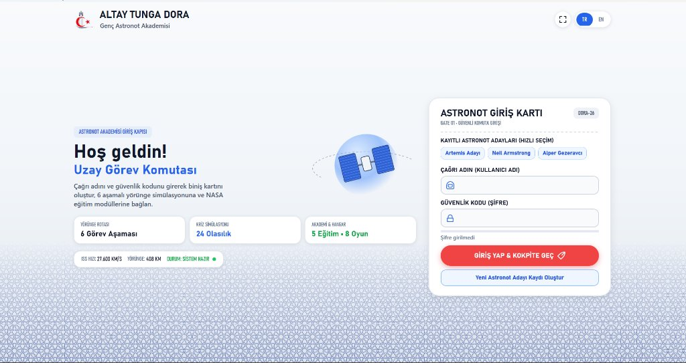
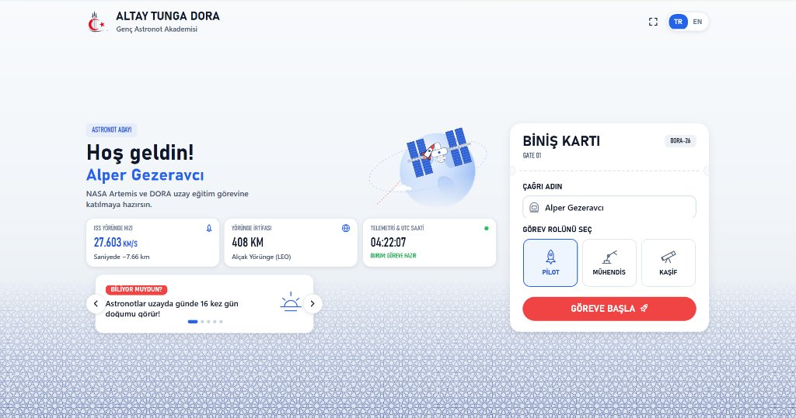
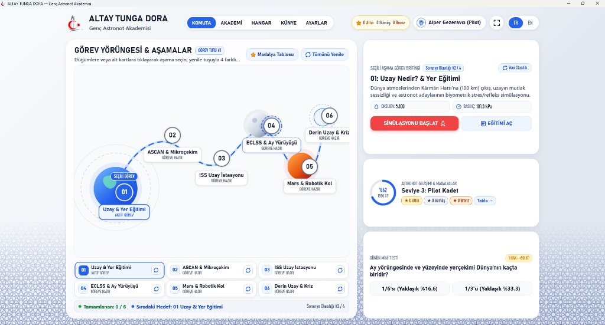
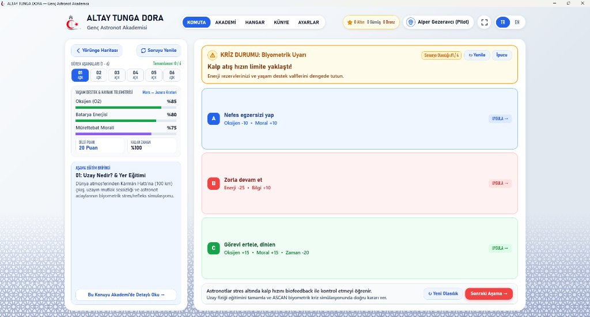
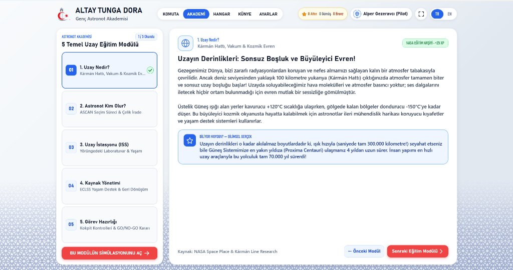
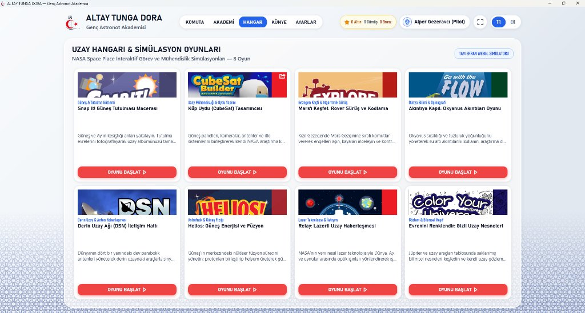
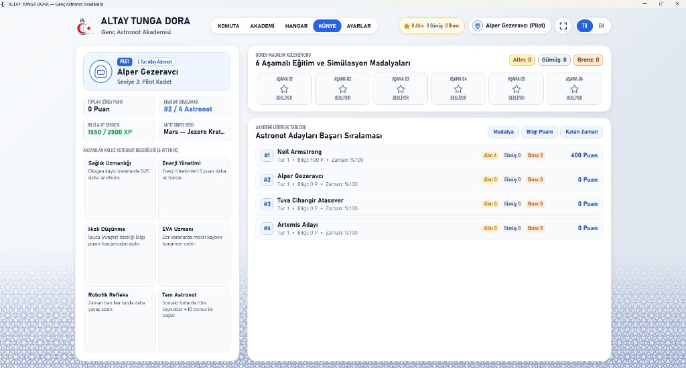
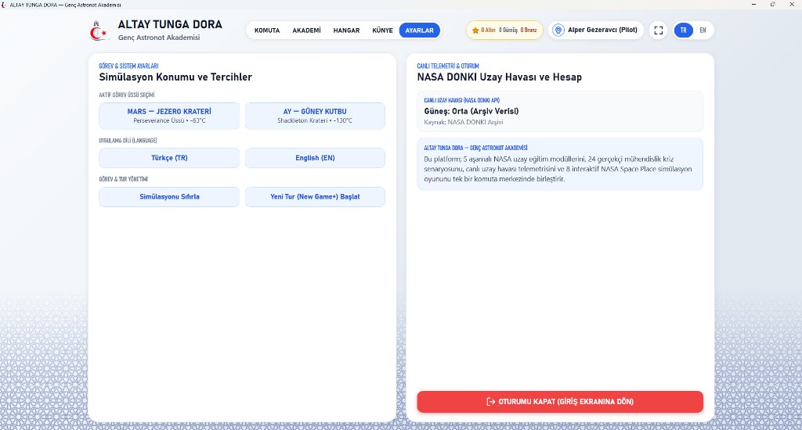

<div align="center">

# 🚀 D.O.R.A. — Derin Uzay Operasyon ve Risk Analizi
### ALTAY TUNGA Genç Astronot Akademisi & Uzay Görev Simülasyonu

[](https://dotnet.microsoft.com/)
[](https://learn.microsoft.com/dotnet/csharp/)
[](https://learn.microsoft.com/dotnet/desktop/wpf/)
[](https://learn.microsoft.com/dotnet/communitytoolkit/mvvm/)
[](https://developer.microsoft.com/microsoft-edge/webview2/)
[](https://api.nasa.gov/)
[](LICENSE)

*Genç araştırmacılara ve uzay meraklılarına uzay bilimini sevdirmek, astronotluk eğitimini deneyimletmek ve kriz anlarında kritik karar verme reflekslerini geliştirmek için tasarlanmış modern masaüstü simülasyon platformu.*

---

[English](README.md) • **Türkçe**

---

[📖 Proje Hakkında](#-proje-hakkında) •
[📸 Ekran Görüntüleri](#-ekran-görüntüleri) •
[✨ Temel Özellikler](#-temel-özellikler) •
[🛰️ Görev Aşamaları](#️-görev-aşamaları-orbit-path) •
[🛠️ Mimari ve Teknolojiler](#️-mimari-ve-teknolojiler) •
[🚀 Kurulum ve Çalıştırma](#-kurulum-ve-çalıştırma) •
[👥 Altay-Tunga Takımı](#-ekip)

</div>

---

## 📖 Proje Hakkında

**D.O.R.A. (Derin Uzay Operasyon ve Risk Analizi)**, Türk gençliğini uzay teknolojileri ve derin uzay operasyonlarıyla tanıştıran, **Altay-Tunga Takımı** tarafından geliştirilmiş kapsamlı bir astronot simülasyon ve eğitim yazılımıdır. 

Uygulama, astronot adaylarının seçiminden (ASCAN), Uluslararası Uzay İstasyonu (ISS) operasyonlarına, kapalı döngü yaşam destek sistemlerinden (ECLSS) derin uzay fırtınalarına kadar uzanan çok katmanlı bir simülasyon deneyimi sunar.

Canlı **NASA DONKI (Space Weather Database of Notifications, Knowledge, and Information) REST API** bağlantısı ile anlık uzay hava durumu ve güneş patlaması (solar flare) verilerini simülasyona dahil ederek gerçekçi operasyonel kararlar alınmasını sağlar.

---

## 📸 Ekran Görüntüleri

| 🔐 01. Astronot Giriş Kartı | 🛫 02. Launchpad & Biniş Kartı |
|:---:|:---:|
|  |  |
| *SHA-256 güvenli kimlik doğrulama & dinamik parola analizörü* | *Kişiselleştirilmiş biniş kartı, rol seçimi ve canlı telemetri* |

| 🛰️ 03. Görev Yörüngesi & Aşamalar | 🎛️ 04. Kriz Kokpiti & Karar Ağacı |
|:---:|:---:|
|  |  |
| *6 aşamalı dinamik görev yörünge hattı ve ilerleme takibi* | *Oksijen/enerji telemetrisi, canlı kriz senaryosu ve A/B/C kararları* |

| 📚 05. Uzay Akademisi | 🎮 06. Uzay Hangarı & Simülasyonlar |
|:---:|:---:|
|  |  |
| *5 modüllü interaktif uzay fiziği & astronot eğitim merkezi* | *NASA Space Place altyapılı 8 interaktif mühendislik oyunu* |

| 🏅 07. Künye, Madalyalar & Sıralama | ⚙️ 08. Simülasyon Ayarları & NASA DONKI |
|:---:|:---:|
|  |  |
| *Altay-Tunga amblemli astronot karnesi, madalyalar ve liderlik* | *Mars/Ay üs seçimi, çift dil (TR/EN) ve canlı NASA DONKI telemetrisi* |

---

## ✨ Temel Özellikler

### 🔐 1. Güvenli Giriş & Astronot Oturumu (Login & Authentication)
- **SHA-256 Şifreleme:** Astronot şifreleri tuzlanmış SHA-256 hash algoritmasıyla güvenli saklanır.
- **Dinamik Parola Güç Göstergesi:** Uzunluk, büyük-küçük harf, rakam ve sembol denetimiyle anlık görsel güç geri bildirimi.
- **Hızlı Giriş Profilleri:** Test ve eğitim amaçlı hazır astronot rolleri.
- **Kişiselleştirilmiş İlerleme:** Her astronotun puanları, madalyaları ve rozetleri yerel veritabanında saklanır.

### 🛫 2. Launchpad (Karşılama & Biniş Kartı)
- **Görev Rolü Seçimi:**
  - 🎖️ *Uçuş Direktörü (Flight Director)* — Tüm görevin stratejik liderliği
  - 🛰️ *Görev Uzmanı (Mission Specialist)* — Bilimsel deneyler ve EVA operasyonları
  - ⚙️ *Uçuş Mühendisi (Flight Engineer)* — Telemetri ve sistem bakımı
  - 📦 *Yük Uzmanı (Payload Specialist)* — Kargo ve özel ekipman yönetimi
- **Biliyor Muydun? Bilgi Şeridi:** Mikroçekim, uzay fiziği ve astronot beslenmesi üzerine çift dilli (TR/EN) bilgi kartları.
- **Canlı Telemetri Barı:** Oksijen, kabin basıncı, kalp ritmi ve simülasyon süresi.

### 🎛️ 3. Komuta Merkezi & Entegre Simülasyon Kokpiti (Mission Control)
- **Yörünge Görev Haritası:** 6 aşamalı dinamik ilerleme hattı (tamamlanan, aktif ve kilitli aşamalar).
- **Gerçek Zamanlı Kriz Yönetimi (Decision Tree):**
  - Oksijen, Enerji, Moral, Bilgi ve Zaman kaynak havuzları.
  - A/B/C seçenekli karar mekanizması: Standart, Riskli ve Optimal çözümler.
  - Her seçimde gerçek **NASA Bilimsel Gerçekleri** (Learning NASA Facts) ve rehber ipuçları.
- **NASA DONKI Canlı Uzay Hava Durumu:**
  - Gerçek zamanlı API sorgusu ile X, M veya C-sınıfı güneş fırtınalarının telemetriye yansıması.
- **Entegre WebView2 Simülasyonları:**
  - SpaceX ISS Kenetlenme Simülatörü
  - NASA Eyes on the Solar System
  - NASA Space Place

### 📚 4. Akademi (Space Academy)
- Uzay fiziği, Kármán hattı, roket itki sistemleri ve yaşam destek döngüsü üzerine hazırlanmış modüler eğitim kartları.
- Türkçe ve İngilizce dil desteği ile interaktif öğrenme.

### 🎮 5. Hangar (Uzay Simülasyonları & Mini Oyunlar)
- NASA eğitim oyunları koleksiyonu (Color the Universe, CubeSat, DSN Game, Explore Mars, Helios, Ocean Currents, Relay Laser, Snap It).
- Oyun içi direkt erişim ve öğrenme hedefleri.

### 🏅 6. Künye & Başarılar (Astronaut Dossier)
- Altay-Tunga amblemi ve Türk motifleriyle tasarlanmış resmi astronot karnesi.
- Altın, Gümüş ve Bronz madalya vitrini.
- Açılabilir uzmanlık rozetleri ve performans analizi.

---

## 🛰️ Görev Aşamaları (Orbit Path)

| No | Aşama Adı | Odak Konusu | Temel Zorluk |
|:---:|:---|:---|:---|
| **01** | **Uzay Nedir? & Yer Eğitimi** | Kármán Hattı (100 km), vakum fiziği ve biyometrik stres testleri. | Aday biyometrik krizini yönetmek ve kalkış protokolünü doğrulamak. |
| **02** | **Astronot Seçimi & Mikroçekim** | ASCAN kriterleri, NBL (Neutral Buoyancy Lab) su altı antrenmanı. | Ağırlıksızlıkta güneş paneli ve batarya dengesizliklerini gidermek. |
| **03** | **Uluslararası Uzay İstasyonu (ISS)** | 28.000 km/s hızda yörünge evi, T-38 manevraları ve modül bakımı. | Basınç kaybı ve iletişim kesintisinde yedek sistemleri devreye almak. |
| **04** | **Kaynak Yönetimi & ECLSS** | Kapalı döngü yaşam desteği, Sabatier reaktörleri ve EVA uzay yürüyüşü. | EVA esnasında elbise sızıntısı ve karbondioksit birikimini önlemek. |
| **05** | **Görev Hazırlığı & Robotik Kol** | Uçuş direktörü GO/NO-GO protokolü, Canadarm2 yakalama manevrası. | Kenetlenme sapması ve robotik kol tork arızasını gidermek. |
| **06** | **Derin Uzay & Simülasyon** | Şiddetli güneş patlamaları (CME), radyasyon kalkanı ve derin uzay. | Tüm telemetri kaynaklarını dengede tutarak altın madalya ile görevi tamamlamak. |

---

## 🛠️ Mimari ve Teknolojiler

```
NASA_DORA_Final/
├── NASA.sln                               # Visual Studio / Rider Solution
├── screenshots/                           # Uygulama arayüz ekran görüntüleri (8 Ekran)
├── src/
│   └── NasaAstronautTraining/
│       ├── Assets/                        # Vektörel logolar, motifler ve oyun afişleri
│       ├── Controls/                      # Özel CircularProgressBar ve UI bileşenleri
│       ├── Converters/                    # WPF ValueConverter sınıfları
│       ├── Models/                        # Senaryolar, oturum, aşama ve telemetri modelleri
│       ├── Services/                      # Auth, Score ve NASA DONKI API servisleri
│       ├── ViewModels/                    # MVVM ViewModel yapıları (Main, Login, MissionControl...)
│       ├── Views/                         # XAML ekran tasarımları (Login, Launchpad, MissionControl)
│       ├── App.xaml                       # Uygulama kaynakları ve başlangıç
│       ├── MainWindow.xaml                # Kök pencere ve Scene yönlendirici
│       └── NasaAstronautTraining.csproj   # Proje konfigürasyonu (.NET 9 WPF)
├── .gitignore                             # Git ignore kuralları
├── LICENSE                                # MIT Lisansı
└── README.md                              # Dokümantasyon
```

### Kullanılan Kütüphaneler ve Çatılar
- **.NET 9.0 (net9.0-windows)** — Yüksek performanslı masaüstü çalışma zamanı.
- **WPF (Windows Presentation Foundation)** — Zengin grafik arabirimi ve donanım hızlandırmalı XAML mimarisi.
- **CommunityToolkit.Mvvm (v8.4.2)** — Source generator destekli modern MVVM kütüphanesi (`[ObservableProperty]`, `[RelayCommand]`).
- **Microsoft.Web.WebView2 (v1.0.3065.39)** — Chromium tabanlı gömülü web simülatör entegrasyonu.
- **NASA Open APIs** — Canlı uzay hava durumu ve güneş aktivitesi (DONKI FLR servisi).

---

## 🚀 Kurulum ve Çalıştırma

### Gereksinimler
- **İşletim Sistemi:** Windows 10 (Sürüm 1903+) veya Windows 11
- **Çalışma Zamanı / SDK:** [.NET 9.0 SDK](https://dotnet.microsoft.com/download/dotnet/9.0)
- **IDE:** Visual Studio 2022 (v17.12+) veya JetBrains Rider 2024+

### Adım Adım Kurulum

1. **Depoyu Klonlayın:**
   ```bash
   git clone https://github.com/aemreuzn/NASA-DORA.git
   cd NASA-DORA
   ```

2. **Bağımlılıkları Geri Yükleyin:**
   ```bash
   dotnet restore NASA.sln
   ```

3. **Projeyi Derleyin:**
   ```bash
   dotnet build NASA.sln --configuration Release
   ```

4. **Uygulamayı Çalıştırın:**
   ```bash
   dotnet run --project src/NasaAstronautTraining/NasaAstronautTraining.csproj
   ```

*(Alternatif olarak `NASA.sln` dosyasını Visual Studio veya JetBrains Rider ile açıp doğrudan `F5` tuşu ile başlatabilirsiniz.)*

---

## 👥 Ekip

**ALTAY-TUNGA TAKIMI**  
- **Geliştirici & Tasarım:** Ahmet Emre Uzun ([@aemreuzn](https://github.com/aemreuzn))  
- **Organizasyon / Proje:** NASA Genç Astronot Akademisi — D.O.R.A.

---

## 📄 Lisans

Bu proje [MIT Lisansı](LICENSE) kapsamında lisanslanmıştır. Detaylar için `LICENSE` dosyasına başvurabilirsiniz.
